<!-- Header wave -->
<p align="center">
  
</p>

<!-- Typing animation -->
<p align="center">
  <a href="https://github.com/Danish26-dev">
    
  </a>
</p>

<!-- Phoenix animation (file: assets/phoenix.svg) -->
<p align="center">
  
</p>

<p align="center">
  <a href="https://www.linkedin.com/in/md-danish-ali-dev/"></a>
  <a href="mailto:mddanisha288@gmail.com"></a>
  <a href="https://github.com/Danish26-dev?tab=repositories"></a>
  
</p>

---

## 👋 About

I'm **Md Danish Ali**, a Computer Science undergraduate at Sambhram Institute of Technology, Bengaluru. I build across **agentic AI, Web3, and full-stack systems**, and I learn by making, competing, iterating, and shipping.

- 🤖 Multi-agent systems grounded in evidence and deterministic logic
- 🔐 Privacy-first products: DIDs, Verifiable Credentials, ZKPs, TEE-backed inference
- 🏆 Podium finishes at ETHGlobal Mumbai, COLOSSUS 3.0, and Athernex
- 🌱 Currently exploring: 0G Private Computer, Hedera x402 payments, and agent orchestration with Google ADK

```text
USER INTENT  ->  AI / AGENTS  ->  TOOLS  ->  DETERMINISTIC LOGIC  ->  DATA  ->  REAL-WORLD ACTION
```

---

## 🏆 Hackathons & Achievements

| Result | Event | Project | Prize |
| :-- | :-- | :-- | :-- |
| 🥉 **3rd Prize** | ETHGlobal Mumbai 2026, Hedera Track | [InkLink](https://github.com/Danish26-dev/InkLink-ethglobal_mumbai) | $1,500 |
| 🥈 **2nd Runner-Up** | COLOSSUS 3.0 National Hackathon 2026, FinTech Domain | [FRAB](https://github.com/Danish26-dev/frabs_colossus3.0) | ₹15,000 |
| 🥇 **1st Place** | Athernex Hackathon, Automaton.ai Track | [Automaton Nexus](https://github.com/GonchiJoshnaVardhanReddy/automaton-nexus) | ₹20,000 |
| 🏅 **Finalist** | Cardano Hackathon, India Blockchain Week 2025 | [IdentiPI](https://github.com/Danish26-dev/IdentiPI) | |
| 🚀 **Submission** | Midnight Hackathon | [IdentiPI](https://github.com/Danish26-dev/IdentiPI) | |

---

## 🚀 Featured Builds

### [FRAB](https://github.com/Danish26-dev/frabs_colossus3.0): Fraud Response & Autonomous Backbone
Agentic financial-security platform that proactively investigates suspicious activity using coordinated AI agents (Supervisor, Watchman, Detective, Jurist, Scribe), deterministic risk intelligence, and TEE-backed private inference on 0G Private Computer.

`Google ADK` `Gemini` `Gemma` `React` `FastAPI` `Firestore` `GCP Confidential VM` `0G Private Computer`

### [InkLink](https://github.com/Danish26-dev/InkLink-ethglobal_mumbai): Decentralized Printing Network
A decentralized, privacy-first printing network combining local AI agents, 0G Private Computer, autonomous Hedera x402 payments, and ESP32-powered physical execution, built on the principles of CROPS.

`Hedera x402` `0G Private Computer` `AI Agents` `ESP32`

### [Automaton Nexus](https://github.com/GonchiJoshnaVardhanReddy/automaton-nexus): AI Voice Agent Platform
Multilingual AI voice agent that automates customer order-confirmation workflows, with a low-latency decision pipeline that combines rule-based logic and AI inference.

`Voice AI` `Node.js` `Modular backend` `Campaign automation`

### [IdentiPI](https://github.com/Danish26-dev/IdentiPI): Decentralized Identity Platform
Privacy-first decentralized identity platform that unifies Verifiable Credentials under a single DID and enables Zero-Knowledge Proof verification without exposing sensitive personal data.

`Midnight` `Compact` `ZKP` `Veridian` `React` `Express` `IPFS`

---

## 🧩 More Builds

| Project | What it does | Stack |
| :-- | :-- | :-- |
| [MilkyWay](https://github.com/Danish26-dev/milkywayai) | Tracks milk supply-chain events, detects discrepancies, and gives officers an evidence trail | `Gemini` `Google ADK` `MCP` `BigQuery` `Cloud Run` |
| [ABIL](https://github.com/Danish26-dev/-ABIL-Agent-Based-Interoperability-Layer) | Middleware for schema translation, bidirectional sync, and reconciliation between government systems | `React` `Node.js` `Socket.IO` `MongoDB` `AWS Bedrock` |
| [Artic](https://github.com/Danish26-dev/Artic-Multi-Agent-Contract-Intelligence) | Clause-level contract intelligence that surfaces risk and drafts safer clauses | `FastAPI` `Gemini` `MongoDB` `React` |
| [PrintX](https://github.com/Danish26-dev/PrintX) | Natural-language print instructions to agent planning and deterministic execution | `AWS Bedrock` `Strands` `Docker` |
| [synapse](https://github.com/Danish26-dev/synapse) | Multi-agent civic complaint resolution: duplicate detection, priority scoring, routing | `Google ADK` `Gemini` `TypeScript` |
| [Eduflix](https://github.com/Danish26-dev/Eduflix) | Topic to story, Manim animation, rendered video, and quiz through an n8n pipeline | `n8n` `Manim` `JavaScript` |
| [CoCoach](https://github.com/Danish26-dev/CoCoach) | Multimodal AI coaching with pose estimation, smartwatch signals, and 3D avatars | `Pose estimation` `IoT` `HTML` |

---

## 🛠️ Tech Stack

<p align="center">
  
</p>

| Area | Tools |
| :-- | :-- |
| **AI & Agents** | `Google ADK` `Gemini` `Vertex AI` `AWS Bedrock` `Strands` `MCP` `RAG` `n8n` |
| **Web3** | `Hedera` `x402` `Cardano` `Aiken` `Midnight` `DID` `VC` `ZKP` `0G Private Computer` |
| **Build** | `React` `Node.js` `Express` `FastAPI` `TypeScript` `REST APIs` |
| **Data** | `MongoDB` `Firestore` `Firebase` `BigQuery` `Supabase` |
| **Cloud & Delivery** | `Docker` `Google Cloud` `Cloud Run` `Confidential Computing` `Vercel` |

---

## 📊 GitHub Stats

<p align="center">
  
  
</p>
<p align="center">
  
</p>
<p align="center">
  
</p>

---

## 🐍 Contribution Snake

<p align="center">
  <picture>
    <source media="(prefers-color-scheme: dark)" srcset="https://raw.githubusercontent.com/Danish26-dev/Danish26-dev/output/github-snake-dark.svg" />
    <source media="(prefers-color-scheme: light)" srcset="https://raw.githubusercontent.com/Danish26-dev/Danish26-dev/output/github-snake.svg" />
    
  </picture>
</p>

<p align="center"><code>BUILD -> EXPERIMENT -> ITERATE -> SHIP</code></p>

<!-- Footer wave -->
<p align="center">
  
</p>
# Danish26-dev
